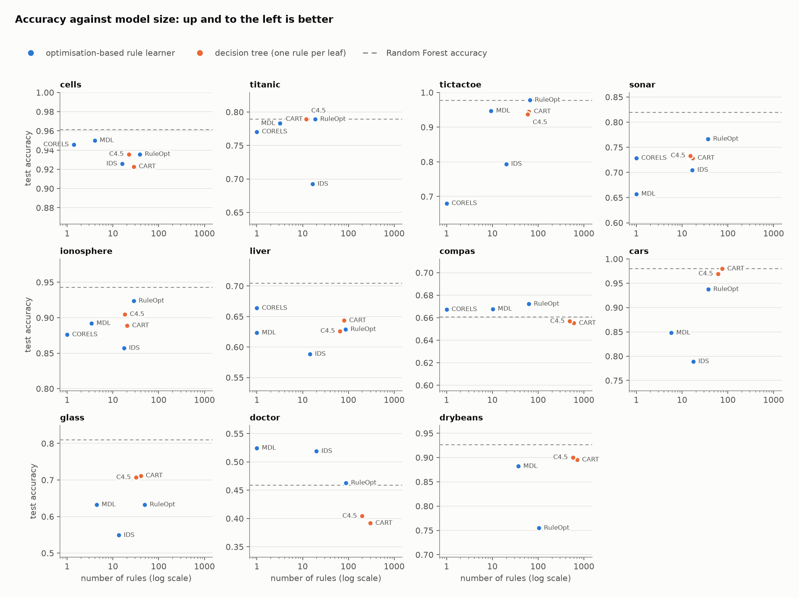
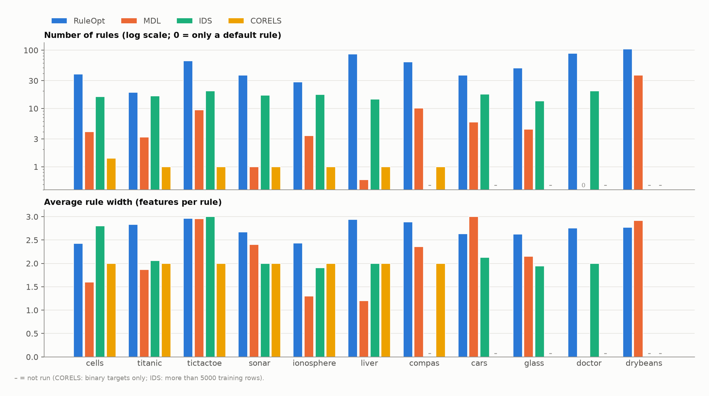
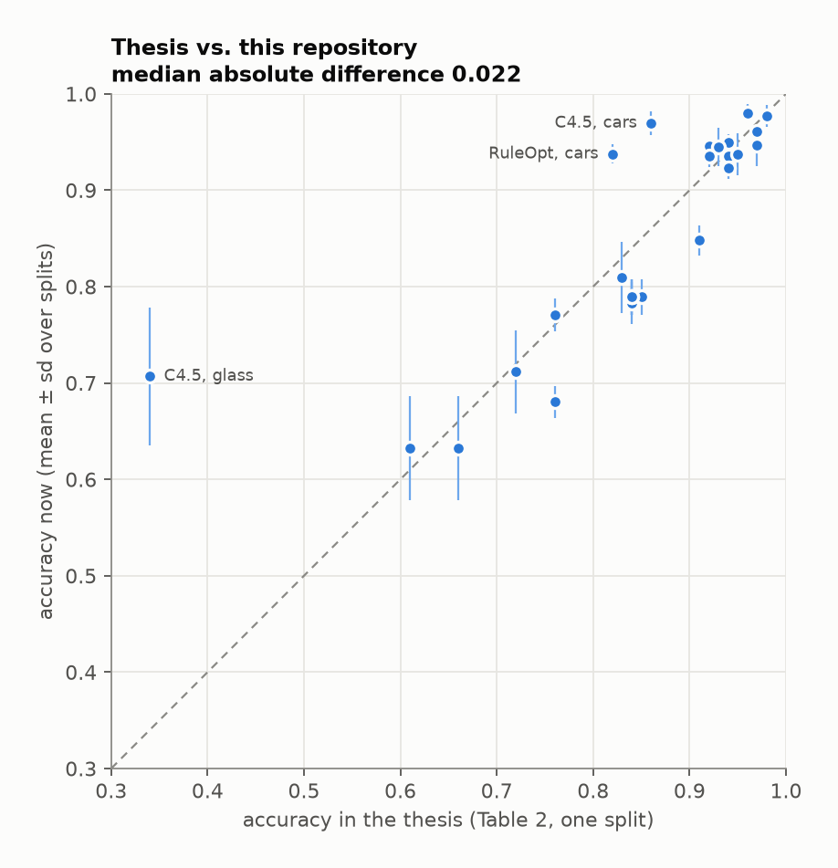
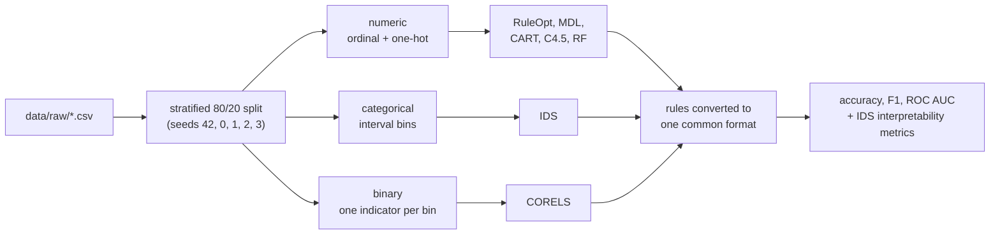

# Rule-based explainable ML with mathematical optimisation

[](https://github.com/QBKFD/XAI-ML/actions/workflows/tests.yml)


Code and results for my bachelor thesis in Business Analytics at the University
of Amsterdam (2024, supervised by Tabea Röber):
*Explainable machine learning using mathematical optimization: rule based
methods* ([PDF](docs/thesis.pdf)).

The thesis compares four rule learners that are each built around an
optimisation problem: find a small set of IF-THEN rules that balances accuracy
against size. They are compared with each other and with three tree baselines
on 11 public datasets, both on predictive performance and on how simple the
learned rules are.



| Method | Output | How the rules are found | Package |
|---|---|---|---|
| **RuleOpt** (Lumadjeng et al., 2023) | weighted rule set | linear program over candidate rules taken from decision trees, solved with column generation | [`ruleopt`](https://github.com/sametcopur/ruleopt) |
| **MDL** / CLASSY (Proença & van Leeuwen, 2020) | rule list | greedy search that minimises description length; nothing to tune | [`rulelist`](https://github.com/HMProenca/RuleList) |
| **IDS** (Lakkaraju et al., 2016) | unordered rule set | seven-term objective (size, length, overlap, coverage, ...) optimised by local search over mined association rules | [`pyIDS`](https://github.com/jirifilip/pyIDS) |
| **CORELS** (Angelino et al., 2018) | rule list | branch and bound with a certificate of optimality; binary features and targets only | [`corels`](https://github.com/corels/pycorels) |
| CART, C4.5, Random Forest | trees | baselines with library defaults; each tree leaf counts as one rule | scikit-learn |

## Results

Five stratified 80/20 splits per dataset, every model with default settings
(as in the thesis). Full numbers are in
[`results/benchmark/summary.csv`](results/benchmark/summary.csv), one row per
run in [`raw_results.csv`](results/benchmark/raw_results.csv), and the learned
rules of the first split in [`results/benchmark/rules/`](results/benchmark/rules).

**Test accuracy** (mean over the five splits; the best rule learner per row in bold):

| Dataset | RuleOpt | MDL | IDS | CORELS | CART | C4.5 | Random Forest |
|---|---:|---:|---:|---:|---:|---:|---:|
| `cells` | 0.94 | **0.95** | 0.93 | 0.95 | 0.92 | 0.94 | 0.96 |
| `titanic` | **0.79** | 0.78 | 0.69 | 0.77 | 0.79 | 0.79 | 0.79 |
| `tictactoe` | **0.98** | 0.95 | 0.79 | 0.68 | 0.94 | 0.94 | 0.98 |
| `sonar` | **0.77** | 0.66 | 0.70 | 0.73 | 0.73 | 0.73 | 0.82 |
| `ionosphere` | **0.92** | 0.89 | 0.86 | 0.88 | 0.89 | 0.90 | 0.94 |
| `liver` | 0.63 | 0.62 | 0.59 | **0.66** | 0.64 | 0.63 | 0.70 |
| `compas` | **0.67** | 0.67 | n/a | 0.67 | 0.66 | 0.66 | 0.66 |
| `cars` | **0.94** | 0.85 | 0.79 | n/a | 0.98 | 0.97 | 0.98 |
| `glass` | **0.63** | **0.63** | 0.55 | n/a | 0.71 | 0.71 | 0.81 |
| `doctor` | 0.46 | **0.52** | 0.52 | n/a | 0.39 | 0.40 | 0.46 |
| `drybeans` | 0.75 | **0.88** | n/a | n/a | 0.90 | 0.90 | 0.93 |

`n/a`: CORELS only handles binary targets, and IDS is not run on training sets
above 5,000 rows (it ran out of memory on 8 GB during the thesis).
ROC AUC: [heatmap](docs/figures/roc_auc_heatmap.png).

What the numbers say:

- **No rule learner matches Random Forest in general.** The best rule learner
  is within 0.02 of it on 6 of the 11 datasets, mostly the
  binary ones, and 0.04-0.18 behind on the rest, with `glass` the widest gap.
- **RuleOpt** is the most accurate rule learner on 6 datasets
  and has the best ROC AUC among them on 10 of 11. It pays
  for that in size: a median of 50 rules, about as many leaves as
  a CART tree, although its rules are shorter (2.4-3.0 features per rule against 3.8-10.6 for the trees).
- **MDL** gives the most compact models: a median of 4 rules,
  often within a few points of RuleOpt's accuracy, and the most accurate
  rule learner on `cells`, `glass`, `doctor` and `drybeans`. On `doctor` and sometimes `liver` it finds no
  rule worth its description length and returns only the default class.
- **CORELS** with its default regularisation (`c = 0.01`) almost always picks
  a single two-condition rule. That is enough on `cells`, `titanic` and
  `liver`, and not on `tictactoe`.
- **IDS** with untuned weights is the weakest and slowest method: the least
  accurate rule learner on 6 of the 9 datasets it runs on, and
  77 s per fit on `cells`, where the other rule learners need
  about a second. Its rules leave many rows to the default class (on average
  45% of test rows are covered by no rule). Its weights have to
  be tuned, see below.



Example rules learned on the first split. MDL on `cells`
([all rule files](results/benchmark/rules)):

```
IF UnifShape >= 3 AND BareNuc >= 3 THEN malignant
ELSE IF UnifSize >= 7 THEN malignant
ELSE IF MargAdh >= 6 AND BlandChrom >= 3 AND BareNuc >= 1 THEN malignant
ELSE IF Clump >= 8 THEN malignant
ELSE PREDICT benign
```

CORELS on `titanic`:

```
IF NOT Passenger_Cat=3rd_class AND NOT Gender=male THEN survived
ELSE PREDICT died
```

### Tuning

`scripts/tune.py` repeats the tuning step of the thesis on the training part
of the first split: a 5-fold grid search for RuleOpt and coordinate ascent
over the seven IDS weights (each searched in 1-400 as in the thesis, with a
ternary-search precision of 100 instead of 50 to keep the run time down). Test results with package defaults and after tuning:

| Model | Dataset | Accuracy | ROC AUC | Rules | Rule width |
|---|---|---|---|---|---|
| RuleOpt | `cells` | 0.92 → 0.94 | 0.99 → 0.97 | 32 → 15 | 2.5 → 1.7 |
| RuleOpt | `glass` | 0.65 → 0.77 | 0.86 → 0.94 | 45 → 36 | 2.7 → 3.7 |
| RuleOpt | `titanic` | 0.76 → 0.76 | 0.73 → 0.63 | 22 → 9 | 2.8 → 2.0 |
| RuleOpt | `cars` | 0.87 → 0.99 | 0.97 → 1.00 | 25 → 67 | 2.7 → 4.8 |
| IDS | `glass` | 0.51 → 0.56 | 0.61 → 0.79 | 23 → 15 | 2.0 → 2.0 |
| IDS | `titanic` | 0.69 → 0.75 | 0.52 → 0.69 | 20 → 20 | 2.1 → 2.1 |
| IDS | `cars` | 0.80 → 0.79 | 0.89 → 0.89 | 18 → 20 | 2.1 → 2.2 |

For RuleOpt, tuning mostly picks deeper trees on the multi-class data (higher
accuracy on `glass` and `cars`, more rules on `cars`) and shallower ones on the
binary data (half the rules or fewer on `cells` and `titanic`). For IDS, accuracy and
ROC AUC go up on `glass` and `titanic`. On `titanic` and `cars` no single-weight change beat the random starting point of the search on the validation part, so the reported weights are that starting point, and the test differences there are not a search result. The IDS search on `cells` (over a minute per fit) did not finish within the time available and is not included. Chosen parameters are in
[`results/tuning/`](results/tuning).

## Differences from the thesis

Rerunning everything on current library versions turned up a few problems in
the original notebooks (kept unchanged in [`notebooks/thesis/`](notebooks/thesis)).
The thesis tables are in [`results/thesis/`](results/thesis) as they were
published. Most accuracies agree within a few points. The largest gaps come
from the first two items below; two others, RuleOpt on `cars` (0.82 then,
0.94 now) and CORELS on `tictactoe` (0.76 then, 0.68 now), probably come from
the newer RuleOpt release and a different binarisation of the board, but were
not traced further.



- **Titanic target.** The MDL notebook took the last column of
  `titanic_binarized.csv` as the label. That column is `Gender_male`, not
  `Died`; the printed rule list in the notebook says `target = Gender_male`.
  The 0.84-0.85 accuracies reported for titanic most likely have the same
  cause: CORELS, the one notebook that named `Died` explicitly, got 0.76 in
  the thesis, and the models here reach 0.69-0.79 on the correct target.
- **C4.5 baseline.** The `c45-decision-tree` package used in the thesis adds
  up the split information over all attributes instead of resetting it for
  each one, and treats every distinct numeric value as a separate category.
  That is why it scored 0.34 on `glass`. It is replaced by a scikit-learn tree
  with the entropy criterion and at least two samples per leaf, which is
  close to C4.5's defaults.
- **Tic-tac-toe.** The raw file has no header row, so reading it with a header
  dropped the first game. Fixed.
- **Preprocessing without leakage.** Discretisation and one-hot encoding used
  to be done on the full file before splitting. They are now fitted on the
  training split only. The hand-picked cut points for `cells` are kept; other
  numeric columns are cut at training-set tertiles.
- **Evaluation.** A single 80/20 split (unseeded for CORELS) became five
  stratified splits. Precision, recall and F1 are macro-averaged for every
  model; the thesis mixed binary and macro averages.
- **Library versions.** RuleOpt 1.2 solves with HiGHS and no longer accepts
  `max_features`, `max_leaf_nodes` or `min_impurity_decrease`, so the grid
  uses the remaining parameters. MDL and IDS no longer need `pandas==1.5.3`:
  [`compat.py`](xai/compat.py) restores the few removed numpy and
  pandas names they call.

## How the comparison is set up



Each method gets the input it needs, built by an encoder fitted on the
training split. Every learned model is converted to the same
[`Rule`](xai/rules.py) objects, so rule counts, widths, coverage and
overlap are computed by one function for all methods (a test checks that it
reproduces pyIDS's own numbers). The interpretability metrics are the ones
defined for IDS and used in the thesis:

| Metric | Meaning |
|---|---|
| `n_rules` | rules in the model, not counting the default rule |
| `avg_rule_width` | features tested per rule |
| `frac_overlap` | average share of rows covered by two rules at once (per pair) |
| `frac_uncovered` | share of rows no rule covers, so the default rule decides |
| `frac_classes` | share of classes that at least one rule predicts |

A model that crashes, times out (300 s per fit) or does not apply to a dataset
is recorded with its status and the run continues.

## Running it

Python 3.10-3.12. RuleOpt and the baselines install from PyPI as usual. MDL,
IDS and CORELS are unmaintained and need a small install script: it installs
them without their outdated pins and builds CORELS from source with a patch
for current Python and numpy (needs a C++ compiler; set `SKIP_CORELS=1` to
skip it).

```bash
python -m venv .venv && source .venv/bin/activate
pip install -e ".[dev]"
bash scripts/install_legacy_deps.sh

pytest                                   # ~10 s
python scripts/run_benchmark.py          # ~20 min, mostly IDS
python scripts/make_figures.py
python scripts/tune.py ruleopt           # ~1 min
python scripts/tune.py ids               # ~5 min per dataset, hours for cells
```

`make install`, `make test`, `make benchmark` and `make figures` do the same.
The exact package versions behind the published results are in
[`requirements.txt`](requirements.txt). Smaller runs:

```bash
python scripts/run_benchmark.py --datasets cells titanic --seeds 42 --models ruleopt mdl cart
```

Using a model directly:

```python
from xai.experiment import make_split
from xai.models import get_model
from xai.rules import format_rules

split = make_split("titanic", seed=42)
X_train, X_test = split.view("binary")        # CORELS needs 0/1 features
model = get_model("corels").fit(X_train, split.y_train)
print(format_rules(model.rules_, ordered=model.ordered))
# IF NOT Passenger_Cat=3rd_class AND NOT Gender=male THEN survived
# ELSE PREDICT died
```

## Repository layout

```
├── configs/benchmark.yaml      datasets, models, seeds, per-dataset settings
├── data/raw/                   the 11 datasets as downloaded
├── docs/                       thesis PDF and README figures
├── notebooks/thesis/           original notebooks, unchanged
├── results/
│   ├── benchmark/              raw_results.csv, summary.csv, learned rules
│   ├── thesis/                 tables from the thesis, transcribed
│   └── tuning/                 RuleOpt grid search, IDS weight search
├── scripts/                    run_benchmark.py, tune.py, make_figures.py, install script
├── tests/
└── xai/
    ├── datasets.py             dataset registry and loading
    ├── encoding.py             numeric / categorical / binary encoders
    ├── models/                 one wrapper per method, common interface
    ├── rules.py                common rule format
    ├── metrics.py              predictive and interpretability metrics
    ├── experiment.py           benchmark loop
    ├── plotting.py             figures
    └── compat.py               patches for the legacy packages
```

## Datasets

| Dataset | Rows | Features | Classes | Smallest class | Task |
|---|---:|---:|---:|---:|---|
| `cells` | 699 | 9 | 2 | 34% | Breast cancer cytology, benign vs. malignant |
| `titanic` | 1,761 | 3 | 2 | 33% | Titanic passengers, survived vs. died |
| `tictactoe` | 958 | 9 | 2 | 35% | Tic-tac-toe end games, does x win |
| `sonar` | 208 | 60 | 2 | 47% | Sonar returns, mine vs. rock |
| `ionosphere` | 315 | 34 | 2 | 36% | Radar returns, good vs. bad (pre-discretised) |
| `liver` | 345 | 104 | 2 | 42% | Liver disorders (pre-binarised) |
| `compas` | 7,214 | 27 | 2 | 48% | Two-year recidivism (pre-binarised) |
| `cars` | 1,728 | 6 | 4 | 4% | Car acceptability from price and technical features |
| `glass` | 214 | 9 | 6 | 4% | Glass type from chemical composition |
| `doctor` | 714 | 14 | 3 | 18% | Number of doctors visited by older adults |
| `drybeans` | 13,611 | 15 | 7 | 4% | Dry bean variety from shape measurements |

Sources are listed in [`datasets.py`](xai/datasets.py). `compas` and
`liver` were already binarised when collected, and `ionosphere` was already
discretised.

## References

- Angelino, E., Larus-Stone, N., Alabi, D., Seltzer, M., & Rudin, C. (2018). Learning certifiably optimal rule lists for categorical data. *JMLR*, 18(234).
- Lakkaraju, H., Bach, S. H., & Leskovec, J. (2016). Interpretable decision sets: a joint framework for description and prediction. *KDD*.
- Lumadjeng, A. C., Röber, T., Akyüz, M. H., & Birbil, Ş. İ. (2023). Rule generation for classification: scalability, interpretability, and fairness. [arXiv:2104.10751](https://arxiv.org/abs/2104.10751).
- Proença, H. M., & van Leeuwen, M. (2020). Interpretable multiclass classification by MDL-based rule lists. *Information Sciences*, 512. [arXiv:1905.00328](https://arxiv.org/abs/1905.00328).
- Rudin, C. (2019). Stop explaining black box machine learning models for high stakes decisions and use interpretable models instead. *Nature Machine Intelligence*, 1(5).

The full reference list is in the thesis.
